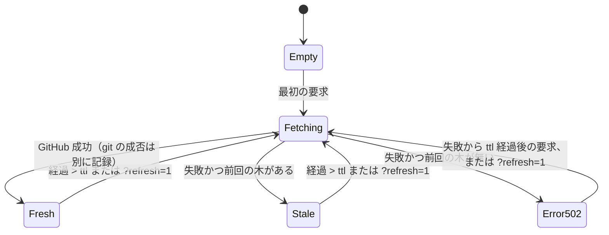

# Issue #176: spec: 進捗一覧 web server（閲覧のみ）

## メタ情報

- 作成日: 2026-10-23
- ステータス: implemented（/review 8 観点を反映した第 3 版。#177）
- 親: task #172 / epic #170
- ブランチ: `spec/176-progress-server`

## 1. 目的

epic → (sub-epic) → task → issue の木と、各 issue の作業状態（ブランチ・worktree の有無、PR、状態ラベル）を
ブラウザで一覧できるようにする。複数のプロジェクトを並行する研究者が、開いた瞬間に
**「要対応」「作業中」「次の候補」**を読めることを主な用途とする。`/issue-scan` は会話に結果を出すだけで、全体を眺める手段が無い。

## 2. 前提（ユーザー確定事項。epic #170 の原文）

- 2026-10-22: データ源は gh CLI で GitHub を読む（スナップショットを別に作らない）
- 2026-10-22: 範囲は「閲覧のみ。回答は後で」（書き込みはしない。QA の回答は #179）
- 2026-10-23: 「tokenの量が増える変更や、merge前のtestに時間がかかる変更は嫌なんですよね。」
  → 常時読み込みのファイル（rules・CLAUDE.md・スキル本文）に記述を足さない。テストは 1 秒未満で、ネットワークも git も使わない

## 3. 入力 → 処理 → 出力

| 段 | 内容 | 実体 |
|---|---|---|
| 取得（GitHub） | 下の GraphQL を `gh api graphql --paginate --slurp` で全ページ取る（cursor は `$endCursor`）。**全ページが成功し、番号で重複を除いた件数が `totalCount` と一致したときだけ**採用する。1 ページでも失敗・件数不一致なら取得全体を失敗にする（一部だけの木を出さない） | `scripts/progress/progress_gh.py`（コマンド実行と `FetchError` は `progress_cmd.py`） |
| 取得（ローカル git） | `git for-each-ref refs/heads refs/remotes`（`*/HEAD` を除き、ローカルとリモートの同名は 1 つにまとめる）と `git worktree list --porcelain`（`-z` は使わない。git 2.34 に無い。`locked`・`prunable`・`detached`・`bare` 行を許容）。**fetch はしない**（リモートのブランチは最後に fetch した時点の値。画面に注記する） | `scripts/progress/progress_git.py` |
| ラベル定義 | 表示する repo（cwd）の `scripts/setup-labels.sh`、無ければ server の隣を読む。読めない・「種類」の見出しが無いときは**ラベルに基づく検査をしない**と帯に出す（全 issue に誤った注記を付けない） | `server.py` |
| 組み立て | 下の規則で木と状態を作る | `scripts/progress/progress_tree.py`（純関数。ネットワーク・git を呼ばない） |
| 出力 | `GET /` 静的な HTML 1 枚（`/api/tree.json` を取得して描画）。`GET /api/tree.json` 木と要約と取得状態 | `scripts/progress/server.py`、`scripts/progress/index.html` |

GraphQL（1 ページ 100 件。実測 1 ページ約 1.1 秒・コスト 2）:

```graphql
issues(first:100, after:$endCursor, states:[OPEN,CLOSED]) {
  totalCount pageInfo { hasNextPage endCursor }
  nodes { number title state stateReason url updatedAt
    labels(first:20) { totalCount nodes { name } }
    parent { number repository { nameWithOwner } }
    closedByPullRequestsReferences(first:10, includeClosedPrs:true) { totalCount nodes { number state url } } } }
```

### 3-1. 規則

| 項目 | 規則 |
|---|---|
| 親子 | `parent` で張る（本文は読まない）。親が別 repo、または取得集合に無いものは根に置き、印「親 #N が一覧に無い」を付ける |
| 種別 | ラベル `epic` → epic、`task` → task、それ以外 → issue 層。`epic` と `task` が両方付いていたら印 |
| ブランチ → issue | 接頭辞は問わない（ラベル名と一致しないため。例 `bug` → `fix/`）。**先に** `^[a-z][a-z-]*/(\d+)-i(\d+)$`（task 単位の worktree を使う派生プロジェクトの形。2 つ目の番号が issue）を当て、合わなければ `^[a-z][a-z-]*/(\d+)(-\|$)`（issue 単位）。`pre-task/`・`pre-epic/`（退避ブランチ。日付が番号に見える）は除く。取り出した番号が取得集合に無いものは捨てる。task 単位のブランチのうち **issue が OPEN のもの**は task にも「配下で作業中」として集計する |
| 作業中 | **OPEN かつ**（ブランチがある、または prunable でない worktree がある）。CLOSED でブランチ・worktree が残るものは「残骸」の印（作業中に数えない） |
| PR | `closedByPullRequestsReferences`（closing keyword で紐づいた PR だけ。画面に注記） |
| 進捗 | 子孫の葉のうち CLOSED の数 / （全数 − 見送り）。見送り＝ `stateReason` が NOT_PLANNED か DUPLICATE。**見送った親の配下の葉は全部見送り**に数え、件数を別に出す。子の無い epic・task は「子なし」 |
| 要約 | **要対応**: OPEN で `user-action` か `blocked`。**作業中**: 上の定義。**次の候補**: OPEN な task ごとに、作業中の子が無ければ、OPEN な issue 層の子を既定の順（survey → spec → feature → validation → experiment → その他、同順位は番号順）に並べた先頭の 1 件。先頭が要対応なら出さない（要対応に出ている）。git が読めなければ作業中・次の候補とも「不明」 |
| 逸脱の印・注記（既定は非表示。切り替えで表示） | 印: task の親が epic でない（親なしを含む）、epic 直下の issue 層、種類ラベルが 2 個以上、親が一覧に無い、親子の循環（そこで切って根にする）、`first:N` の上限超え。epic の親が epic なのは逸脱でない（sub-epic）。注記（逸脱ではない）: 報告ラベル（`review-integrity`）の issue は「報告 issue」、種類ラベルが無くテンプレート外のラベルがある issue は「テンプレート外のラベル」、どちらも無ければ「種類ラベルなし」、残骸、子なし |

### 3-2. 状態遷移（サーバーのキャッシュ）



- 取得は lock で 1 本にまとめる（`ThreadingHTTPServer`）。待っていた要求は、自分が来た後に終わった取得の結果を使う（`?refresh=1` が重なっても取得は 1 回）
- 失敗した後も ttl 秒は取り直さない（GitHub が落ちている間、要求のたびに最大 60 秒待たせない）
- 失敗は種類を問わず（`FetchError` 以外の例外も）前回の木を残して帯に出す。接続を黙って切らない
- `?refresh=1` は header `X-Progress-Refresh: 1` が付いたときだけ効く（ページの JS が付ける。他のサイトの `` 等から利用者の GitHub の利用枠を使わせない）
- git だけ失敗したら、木は出して「作業中」の列を「不明（理由）」にする（全員を作業中でないとは言わない）
- issue 0 件の repo は 200 で空の木

## 4. 動かし方

```bash
python3 scripts/progress/server.py [--port 8765] [--ttl 60]
```

- 対象 repo は cwd の `gh repo view`（`--repo` は持たない。GitHub と手元の git が別の repo を指す食い違いを作らない）
- `127.0.0.1` に bind する。Host ヘッダが `127.0.0.1:<port>` か `localhost:<port>` でなければ 403（DNS rebinding で非公開 repo を読ませない）
- 依存は Python 3.9 以上の標準ライブラリと `gh`（2.48 以上。`--slurp`）と `git`
- port が使用中なら 1 行の ERROR を出して終了する

## 5. 画面

- 上部: 取得時刻（JST）と TTL、取得失敗なら赤枠の帯「取得失敗 HH:MM — 表示は HH:MM 時点（理由）」、要約の 3 群（件数と一覧）
- 既定は OPEN だけ。epic を展開、CLOSED の子は「+N closed」に畳む。親も子も無い根は末尾の「親なし (N)」に畳む
- 折りたたみは `<details>/<summary>`。状態は文字のバッジ（色だけに頼らない）。`prefers-color-scheme` で暗色
- 絞り込み（closed も表示・ラベル・タイトルか `#番号`）は URL の query に持つ（再読み込み・共有で残る）。closed の親は、見える子孫があれば出す（open の子を隠さない）
- 逸脱の印と注記は 1 つの切り替えで出す（既定は非表示）
- 描画は `textContent` だけ（`innerHTML` にデータを入れない）。アクセスログは出さない。ログは stderr に INFO（起動・取得の件数と秒数）/ WARN（古い表示を出す・ラベルの検査をしない）/ ERROR（失敗したコマンドと終了コード、想定外の例外は traceback）

## 6. 制約

- GET 以外は（HEAD・OPTIONS を含めて）405。書き込みの経路を持たない
- 1 ファイル 300 行以内
- `scripts/` 配下なので `/template-sync` で配布される。常時読み込みのファイルには何も足さない
- テストは `scripts/tests/test_progress_*.py`（unittest。品質ゲートが毎回 discover する）と共有 fixture `scripts/tests/progress_fixture.py`。fixture と差し込みの取得関数だけで動き、**合計 1 秒未満**

## 7. 判定（validation #178。対象 repo は omron-sinicx/delta-clip-dev。結果は #178 のコメントに件数と不一致の一覧で残す）

| # | 確かめること | 方法 |
|---|---|---|
| V1 | 親子が GitHub の sub-issue と一致する | `subIssuesSummary.total > 0` の**全ノード**で `gh api --paginate repos/R/issues/N/sub_issues` の番号集合と木の子の集合が一致。逆向きに、`parent` を持つ全 issue が木でその親の下にある |
| V2 | 全件取れている | 重複を除いたノード数 = `totalCount`（100 件超でページ送りを通す） |
| V3 | 作業中の判定 | fixture: `fix/12-x` → 12 が作業中、`survey/756-i770` → 770 が作業中で 756 は「配下で作業中」、CLOSED + ブランチ → 残骸で作業中でない、`pre-task/2026…` は無視。実 repo: worktree を持つ OPEN issue を 1 件ずつ照合 |
| V4 | 逸脱の印 | 逸脱を仕込んだ fixture で印が付き、正常な fixture（sub-epic・`review-integrity`・テンプレート外のラベルを含む）で付かない |
| V5 | 閲覧のみ・Host | POST/PUT/DELETE が 405。Host が別名なら 403。コードに `gh issue edit` / `-X POST` 等が無い |
| V6 | エスケープ | `<script>` を含むタイトルの fixture が JSON にそのまま入り、`index.html` がデータを `innerHTML` に入れていない |
| V7 | 取得失敗 | 2 ページ目で失敗させると一部の木を出さず、前回の木に失敗表示が付く（前回が無ければ 502）。git だけの失敗で「不明」 |
| V8 | 要約 | fixture で 3 群の件数が手で数えた値と一致する |

## 8. 範囲外

- 書き込み（close・ラベル・コメント）
- QA の質問への回答と session への戻し（#179）
- 127.0.0.1 以外への公開

## 変更履歴

- 2026-10-23: 初版
- 2026-10-23: /review-spec（実現性・品質・設計・Fallback・goal 整合・妥当性検証・UI/UX）を反映。ブランチの種類をラベルから読むのをやめた（`fix/` を取りこぼすため）。作業中を OPEN に限った（実測で手元の issue ブランチの 7 割以上が closed issue のもの）。取得は全ページ成功時だけ採用。task 単位のブランチは既に使われているので先に当てる。要約 3 群・既定の表示・Host 検査・V1 を全ノードに拡大・V8 を追加。`--repo` を削除。取得を GitHub とローカル git の 2 ファイルに分割
- 2026-10-23: 実装（#177）の /review 8 観点を反映。次の候補を task ごとに先頭の 1 件にした（実データで 56 件→13 件）。見送りに DUPLICATE と見送った親の配下を含めた。取得の失敗後の待ち、`?refresh=1` の取りまとめと header の要求、ラベル定義が読めないときの扱い、親子の循環、`pre-task/` の除外を足した。`--verbose` を削除
